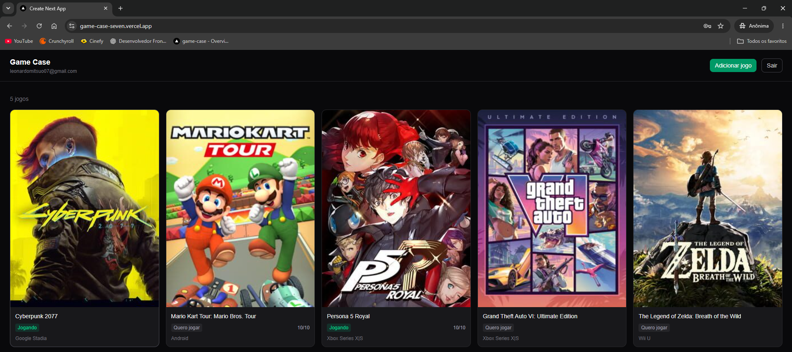

# Game Case

Aplicação web para gerenciar uma coleção de jogos: você busca um título numa base pública, adiciona à sua biblioteca e acompanha o que está jogando, o que zerou e o que ainda quer jogar.

**[🔗 Ver o projeto no ar](https://game-case-seven.vercel.app)**



> **Conta de teste:** a aplicação não exige confirmação de e-mail, então dá para criar uma conta em dez segundos e testar o fluxo completo.

---

## O que a aplicação faz

- Cadastro e login com e-mail e senha, com rotas protegidas
- Busca de jogos na base da IGDB, com resultados conforme você digita
- Adicionar um jogo à coleção, com capa e plataforma preenchidas automaticamente
- Editar status (jogando, zerado, quero jogar, abandonado), plataforma, nota e anotações
- Remover um jogo da coleção
- Cada usuário enxerga apenas a própria coleção

## Tecnologias

**Front-end:** Next.js 16 (App Router) · React 19 · TypeScript · Tailwind CSS
**Dados:** Supabase (PostgreSQL + Auth) · Row Level Security
**Formulários:** React Hook Form · Zod
**Testes:** Vitest · React Testing Library
**Infra:** Vercel (deploy contínuo)

---

## Decisões técnicas

### Autorização no banco, não no código

A tabela `collection_items` tem Row Level Security ativo e quatro políticas — uma por operação — que comparam `auth.uid()` com a coluna `user_id`:

```sql
alter table collection_items enable row level security;

create policy "usuarios leem a propria colecao"
  on collection_items for select
  using (auth.uid() = user_id);
```

O efeito prático aparece na consulta da coleção, que **não tem filtro por usuário**:

```ts
const { data: itens } = await supabase
  .from('collection_items')
  .select('*')
  .order('created_at', { ascending: false });
```

Não há `.eq('user_id', ...)` porque o banco já restringe as linhas a partir do JWT da requisição. Isso não é só conveniência: se o filtro dependesse do código da aplicação, bastaria esquecer um `.eq` numa consulta futura para vazar dados de outra pessoa. Com RLS, esquecer não é possível.

É também o que torna seguro expor a chave pública do Supabase no navegador — o que protege os dados é a política no banco, não o segredo da chave.

### A chave da API nunca chega ao navegador

A busca de jogos usa OAuth com `client_credentials`, e o `client_secret` não pode sair do servidor. Por isso o navegador não fala com a IGDB: ele chama uma rota da própria aplicação (`/api/jogos`), que roda no servidor, obtém o token e faz a consulta.

```
navegador → /api/jogos → Twitch (token) → IGDB → /api/jogos → navegador
```

Em React puro essa separação não existe: ou a chave fica exposta no bundle, ou é preciso escrever um backend só para isso. Aqui a Route Handler do Next resolve com um arquivo.

O token de acesso vale cerca de 60 dias, então fica guardado em memória e só é renovado quando expira — pedir um novo a cada busca seria desperdício.

### Busca que não desperdiça requisições

Dois problemas aparecem em qualquer busca conforme o usuário digita, e os dois são tratados:

**Uma requisição por tecla.** Um `useEffect` com `setTimeout` agenda a busca para 400ms depois, e a função de limpeza cancela o agendamento anterior a cada tecla. Digitar "portal" rapidamente dispara uma requisição, não seis.

**Respostas fora de ordem.** Se você busca "port" e depois "portal", nada garante que as respostas cheguem na ordem em que saíram — a primeira pode chegar por último e sobrescrever o resultado certo. Cada nova busca aborta a anterior com `AbortController`, e o `AbortError` é tratado como cancelamento, não como falha.

### Trocar de API mexendo em um arquivo só

O projeto nasceu usando a RAWG. Durante o desenvolvimento, a API deles ficou fora do ar por mais de 24 horas, e a migração para a IGDB levou menos de uma hora: **só a Route Handler mudou.**

Isso foi possível porque a rota nunca repassou o formato da API externa para o front. Ela devolve apenas quatro campos, já nomeados como as colunas da tabela:

```ts
const resultados = jogos.map((jogo) => ({
  external_id: String(jogo.id),
  title: jogo.name,
  cover_url: jogo.cover ? `https://images.igdb.com/.../${jogo.cover.image_id}.jpg` : null,
  platforms: jogo.platforms?.map((p) => p.name) ?? [],
}));
```

A tela de busca, o banco e os testes não souberam da troca. É o padrão de camada anticorrupção: o formato de fora não contamina o de dentro.

### Cache que também guarda erro

A primeira versão cacheava a resposta da API externa por uma hora, para economizar cota. O problema apareceu junto com a instabilidade da RAWG: uma falha momentânea ficava congelada por 60 minutos, e o cache sobrevivia inclusive a novos deploys.

A busca passou a usar `cache: 'no-store'`. O debounce já limita o volume de requisições, e uma resposta ruim nunca mais fica presa.

### Jogo duplicado é impedido pelo banco

Um índice único em `(user_id, external_id)` garante que o mesmo jogo não entre duas vezes na mesma coleção, permitindo que pessoas diferentes tenham o mesmo título. A aplicação não consulta antes de inserir: tenta inserir e trata o código `23505` do PostgreSQL.

A diferença importa sob concorrência — dois cliques simultâneos passariam por uma verificação prévia, mas não passam por uma restrição no banco.

---

## Testes

```bash
npm test
```

Dez testes cobrindo as duas pontas que mais quebram em silêncio:

**Componente de card** — título, status traduzido, nota e plataforma; o texto alternativo quando não há capa; o `alt` descritivo quando há; a omissão da nota quando ela é nula; e o aviso ao componente pai quando o card é clicado.

**Schema de validação** — nota fora do intervalo, status fora da lista permitida, anotação acima do limite, e o caso em que a nota não é preenchida.

Os testes verificam comportamento visível, não implementação: reescrever um componente por dentro, mantendo o que aparece na tela, não quebra nenhum deles.

---

## O que eu faria diferente hoje

- **Gerar os tipos a partir do schema do Supabase** — hoje o tipo `ItemColecao` é escrito à mão e há uma asserção de tipo na consulta. Com os tipos gerados, uma coluna renomeada no banco viraria erro de compilação.
- **Filtros e paginação na coleção** — a listagem carrega tudo de uma vez. Com algumas dezenas de jogos funciona; com centenas, não.
- **Testes de integração nos fluxos de autenticação** — login e cadastro são testados manualmente hoje.
- **Estado otimista ao editar** — hoje a tela espera a resposta do servidor antes de atualizar.

---

## Estrutura

```
src/
├── app/
│   ├── page.tsx              # coleção (Server Component)
│   ├── login/
│   ├── cadastro/
│   ├── buscar/               # busca com debounce
│   └── api/jogos/route.ts    # token OAuth + consulta à IGDB
├── components/
│   ├── ListaColecao.tsx      # estado de edição
│   ├── CardJogo.tsx
│   ├── Modal.tsx             # Esc, clique fora, foco preso
│   ├── Toast.tsx             # aviso temporário com dispensa automática
│   ├── FormEditarJogo.tsx    # React Hook Form + Zod
│   └── BotaoSair.tsx
├── lib/
│   ├── supabase/
│   │   ├── client.ts         # cliente do navegador
│   │   └── server.ts         # cliente do servidor
│   └── validacao.ts          # schema Zod
├── types/colecao.ts
└── middleware.ts             # renova sessão e protege rotas
```

Os dois clientes do Supabase existem porque no Next parte do código roda no servidor e parte no navegador, e cada lado lê a sessão de um lugar diferente — dos cookies da requisição ou dos cookies do documento.

---

## Rodando localmente

```bash
git clone https://github.com/LeoMitsuo/game-case.git
cd game-case
npm install
```

Crie um arquivo `.env.local` na raiz:

```
NEXT_PUBLIC_SUPABASE_URL=
NEXT_PUBLIC_SUPABASE_PUBLISHABLE_KEY=
TWITCH_CLIENT_ID=
TWITCH_CLIENT_SECRET=
```

As duas primeiras vêm de um projeto no [Supabase](https://supabase.com); as duas últimas, de uma aplicação registrada no [console de desenvolvedores da Twitch](https://dev.twitch.tv/console), que é como a IGDB autentica.

```bash
npm run dev
```

Para rodar os testes:

```bash
npm test
```

---

## Observações

A aplicação roda no plano gratuito do Supabase, que pausa projetos após sete dias sem acesso. Se a coleção não carregar, é provavelmente isso — me avise e eu reativo.

Dados e imagens de jogos fornecidos por [IGDB](https://www.igdb.com).
